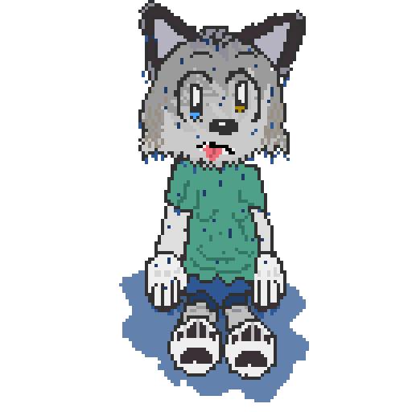

### Legacy Of The Chaos Soul
[Discord Server with LOTCS chat also a minecraft server](https://discord.gg/pD3qwdBd4f)

# Today's To do list:
+~~1. fix _DrawSky() and make sure the main loop is working~~ (might be finished)
+2. continue work on text api
+3. improve documentation
 
##Documentation still under Construction

## Text Api
call _Print_string with x and y then your text then a color and it draws it on the screen
_Print_string(4, 4, “hello”, 0xFFFFFFFF);
a backslash n in the text drops to the next line

for one letter use _Print_char with x y the character and color
_Print_char(100, 50, ‘A’, 0xFFFF0000);

for numbers use _Print_int with x y the number and color
_Print_int(40, 24, score, 0xFFFFFF00);

colors are the same format as the rest of the engine so 0xFFRRGGBB and every letter is 8 pixels wide and 8 tall which is TEXT_CELL_W and TEXT_CELL_H if you want to line stuff up like x plus 2 times TEXT_CELL_W

one big thing call these in your videoloop after the sky and scene stuff so the text lands on top and does not get painted over by _DrawSky

it clips on its own
