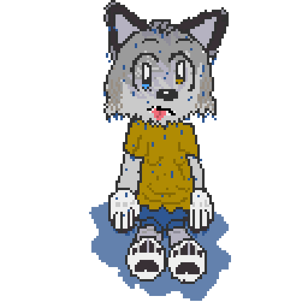

### Legacy Of The Chaos Soul

###### Check out the [discord server](https://discord.gg/pD3qwdBd4f)!

## Compilation on Linux (Final build, Windows 9x compatible):
Install these with your package manager:
- WINE
- GCC
- MinGW-GCC

Install the [MASM32 SDK](http://www.masm32.com/download.htm) to your default WINE prefix, required to assemble Power3D.

Clone the repository & run `build.sh`.

## Compilation on Windows (Debug build):
Install [MSVC](https://visualstudio.microsoft.com/thank-you-downloading-visual-studio/?sku=Community&channel=Stable) & the [MASM32 SDK](http://www.masm32.com/download.htm) (required to assemble Power3D).

Clone this repository.

MSVC will install a file named `VCVARSALL.bat` to your computer, but the path changes between MSVC versions. Find the file in your MSVC install.

Open `build.bat` in notepad. Replace the fake path in line 6 with the FULL `VCVARSALL.bat` path, then run `build.bat`.
