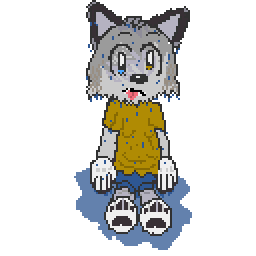

### Legacy Of The Chaos Soul

###### Check out the [discord server](https://discord.gg/pD3qwdBd4f)!

## Compilation:
Linux required! Install these with your package manager:
- WINE
- GCC
- MinGW-GCC

Install the [MASM32 SDK](http://www.masm32.com/download.htm) to your default WINE prefix, which is required to assemble Power3D.

Clone the repository, make sure `build.sh` is executable, then run `build.sh`.
